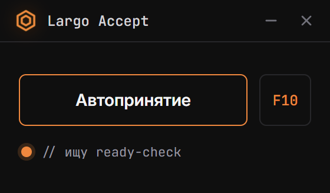

# Largo Accept

Мини-приложение от **Largo Develop**: автопринятие матча Dota 2 (Windows).

<p align="center"></p>

## Как работает
1. Находит окно Dota 2 (`SDL_app` / «Dota 2»).
2. ~2 раза в секунду снимает кадр монитора с игрой (Electron `desktopCapturer`) и вырезает область окна.
3. Ищет на кадре зелёную кнопку «ПРИНЯТЬ» **по цвету и форме, а не по координатам**:
   сплошное зелёное прямоугольное пятно нужного размера (в долях окна) возле центра.
   Поэтому работает на любом разрешении и с Dota+ (там кнопка выше).
4. Кнопка должна продержаться несколько кадров подряд, затем — клик мышью по её центру
   (курсор возвращается на место). Если Dota не на переднем плане, она сначала активируется.
   Если кнопка не исчезла — повторяет клик (до 4 раз за одно появление).

Ничего не читает из памяти игры и не внедряется в процесс: только скриншот и обычный клик.

## Ограничения
- Окно Dota не должно быть **свёрнуто** (в полноэкранном режиме не сворачивай игру через Alt+Tab —
  лучше режим «окно без рамки»).
- Нужна Windows 10/11.

## Запуск
```bash
npm install
npm start
```
Хоткей **F10** — вкл/выкл. Сборка: `npm run build`, ярлык на рабочем столе: `npm run shortcut`.
Скриншот для README: `npx electron scripts/make-screenshot.js`.

## Отладка и настройка
- `LARGO_DEBUG=1 npm start` — при каждом клике сохраняет кадр с рамкой найденной кнопки в
  `%APPDATA%\largo-accept\debug\`. Прикладывай эти кадры к issue, если что-то не находится.
- Пороги цвета и размеров — `electron/detector.js` (`DEFAULTS`).
- `npm test` — проверка детектора на синтетических кадрах.

## Задел на будущее
`electron/future-phone.js` — заглушка под QR / принятие с телефона.
`legacy/` — старая реализация на AutoIt (Enter по таймеру).

## Лицензия
MIT
